

  

  
  
  
  

<h3 align="center">Ayudo a empresas a dejar de <i>suponer</i> y empezar a <i>saber</i>.</h3>

  Análisis de datos y Business Intelligence de punta a punta: <b>construyo</b> los sistemas, <b>formo</b> a los equipos que los usan y <b>comparto</b> lo que aprendo.


  

  <a href="https://drjay2018.github.io/drjay2018/">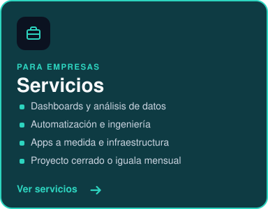</a>
  <a href="https://drjay2018.github.io/drjay2018/#fac">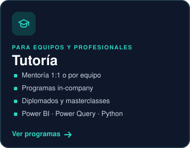</a>
  <a href="https://www.linkedin.com/in/jasser-moreno-medina">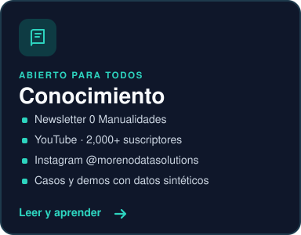</a>

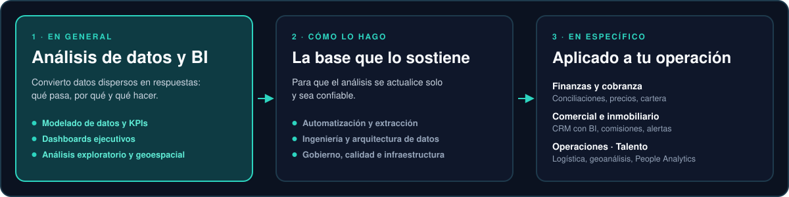

  

  

  <a href="https://drjay2018.github.io/drjay2018/#bi">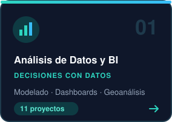</a>
  <a href="https://drjay2018.github.io/drjay2018/#eng">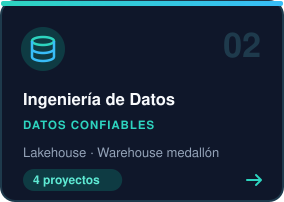</a>
  <a href="https://drjay2018.github.io/drjay2018/#auto">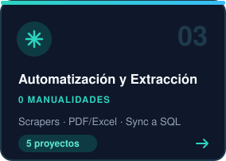</a>
  <a href="https://drjay2018.github.io/drjay2018/#gov">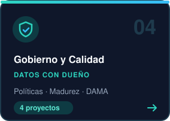</a>
   
  <a href="https://drjay2018.github.io/drjay2018/#app">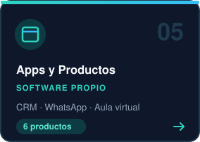</a>
  <a href="https://drjay2018.github.io/drjay2018/#infra">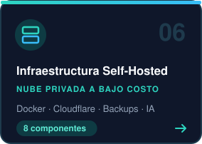</a>
  <a href="https://drjay2018.github.io/drjay2018/#pa">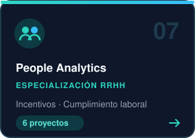</a>
  <a href="https://drjay2018.github.io/drjay2018/#fac">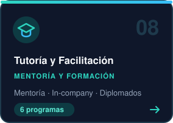</a>

Toca una tarjeta para abrir esa línea en el portafolio interactivo, o despliega el detalle abajo.

<b>01 · Análisis de Datos y BI</b> · 11 proyectos

 

| Proyecto | Problema → Resultado | Stack | Estado |
|---|---|---|:-:|
| **Conciliación tri-fuente** | Cuadrar tres sistemas transaccionales tomaba días. → Diferencias detectadas automáticamente, por socio y por día. | `Power BI` `DAX` `DuckDB` |  |
| **Matriz de desempeño de socios comerciales** | Sin visibilidad del aporte y la salud de cada socio. → Priorización objetiva de la red comercial. | `Power BI` `DAX` |  |
| **Monitor de competitividad de precios** | No se sabía si el precio propio era competitivo cada día. → Decisiones de precio con evidencia diaria. | `Power BI` `DAX` |  |
| **Sistema corporativo de BI (inmobiliaria)** | Gestión comercial sin indicadores consolidados. → Dirección con un tablero único del negocio. | `Power BI` `Excel` |  |
| **Análisis geoespacial de cobertura** | Ubicar sucursales y rutas sin datos de distancia real. → Expansión y logística basadas en mapas. | `osmnx` `geopandas` `folium` |  |
| **Kit de identidad ejecutiva** | Reportes y presentaciones sin estándar visual. → Imagen corporativa consistente en todos los entregables. | `JSON` `pptxgenjs` |  |
| [**Análisis de cesta de supermercado**](https://www.linkedin.com/posts/jasser-moreno-medina_analisis-de-basket-super-power-bi-activity-6994869685607350272-bXb_) | Un retail no sabía qué productos se compran juntos. → Ideas accionables de surtido, ubicación y promociones cruzadas. | `Power BI` `DAX` |  |
| [**Suite de mapas interactivos**](https://www.youtube.com/watch?v=hmv6i9KBqsw&list=PLl0vFx8KRNdckH3FpyAruwFCAzHTEaGCD) | Datos con ubicación analizados solo en tablas. → Patrones territoriales visibles de un vistazo. | `Python` `QGIS` `folium` |  |
| **Algoritmo de capacidad de endeudamiento** | Evaluar capacidad de pago con criterios manuales y dispares. → Decisiones de crédito más consistentes. | `Python` `scikit-learn` |  |
| [**Pruebas Nacionales de República Dominicana**](https://github.com/drjay2018/analisis-pruebas-nacionales-rd) | Los resultados de las Pruebas Nacionales no se analizaban junto con el catálogo de centros ni con el territorio → Notebook público y reproducible con datos abiertos del Estado | `pandas` `GeoPandas` `Folium` `Plotly` |  |
| [**Planteles educativos de República Dominicana**](https://github.com/drjay2018/analisis-de-escuelas-rd) | La oferta educativa, con más de 7,000 planteles, no se veía en conjunto ni sobre el mapa → Notebook público con datos abiertos de datos.gob.do | `pandas` `GeoPandas` `Folium` `Sweetviz` |  |

<b>02 · Ingeniería de Datos</b> · 4 proyectos

 

| Proyecto | Problema → Resultado | Stack | Estado |
|---|---|---|:-:|
| **Lakehouse medallón** | Cientos de millones de filas que Power BI no podía procesar. → Procesamiento local escalable y consultas en segundos. | `DuckDB` `Parquet` `Python` |  |
| **Data warehouse medallón** | Datos operativos sin modelo ni control de calidad. → Base analítica confiable y auditable. | `SQL Server` `SQLAlchemy` `Python` |  |
| **Núcleo multi-tenant de dimensiones** | Cada proyecto replicaba sus propias tablas geográficas. → Dimensiones reutilizables entre proyectos y clientes. | `SQL Server` `Fabric` |  |
| **Pipelines Power Query parametrizados** | Rutas fijas y SQL nativo que rompían los refrescos. → Refrescos estables y portables entre entornos. | `Power Query M` `Dataflow Gen2` `SharePoint` |  |

<b>03 · Automatización y Extracción</b> · 5 proyectos

 

| Proyecto | Problema → Resultado | Stack | Estado |
|---|---|---|:-:|
| **Scraper multi-fuente de tasas de cambio** | Monitorear precios de divisas del mercado era una tarea manual diaria. → Histórico limpio dos veces al día, listo para análisis de competitividad. | `Python` `BeautifulSoup` `Scheduler` |  |
| **Descargador de series oficiales** | Las series del banco central se descargaban y pegaban a mano. → Referencia oficial siempre al día sin intervención. | `Python` `Power Query M` |  |
| **Extractores PDF / Excel / CSV** | Reportes en formatos heterogéneos y carpetas anidadas. → Nuevas fuentes se integran sin tocar código. | `pdfplumber` `openpyxl` `pandas` |  |
| **Sincronización Excel → SQL Server** | Maestros en Excel desalineados con la base de datos. → Base de datos sincronizada sin mantenimiento manual del esquema. | `Python` `SQLAlchemy` `T-SQL` |  |
| **Normalización de matrices anchas** | Reportes con fechas en columnas, imposibles de modelar. → Datos listos para series de tiempo en BI. | `pandas` `Power Query M` |  |

<b>04 · Gobierno y Calidad</b> · 4 proyectos

 

| Proyecto | Problema → Resultado | Stack | Estado |
|---|---|---|:-:|
| **Políticas de gobierno y calidad** | Datos sin dueño ni reglas formales. → Gobierno de datos formalizado y auditable. | `DAMA-DMBOK` |  |
| **Scorecard de madurez** | La alta dirección no conocía el nivel de madurez de datos. → Hoja de ruta priorizada para C-level. | `Excel` |  |
| **Modelo de tres líneas de defensa** | Responsabilidades de datos difusas. → Rendición de cuentas clara. | `DAMA` |  |
| **Normalización de direcciones** | Direcciones libres imposibles de geolocalizar. → Base para análisis territorial confiable. | `Python` `SQL` |  |

<b>05 · Apps y Productos</b> · 6 proyectos

 

| Proyecto | Problema → Resultado | Stack | Estado |
|---|---|---|:-:|
| **DLab CRM** | Inmobiliaria pyme con CRM y ERP desconectados. → Gestión comercial y financiera en una sola herramienta. | `Flask` `SQLAlchemy` `PyInstaller` |  |
| **Orquestador de entregas por WhatsApp** | La última milla dependía de llamadas y apps instaladas. → Entregas trazables sin que nadie instale nada. | `WhatsApp Cloud API` `Python` |  |
| **Alertas de KPIs por WhatsApp** | Los KPIs críticos se revisan tarde. → La alerta llega a quien debe actuar, sin fatiga. | `Python` `JSON` |  |
| **Auditoría de costo de WhatsApp Business** | El gasto en mensajería crece sin control. → Costo de mensajería visible y optimizable. | `Python` |  |
| **Publicación automática en redes** | Publicar con constancia consume tiempo del equipo. → Presencia constante con control de marca. | `Graph API` `ffmpeg` `Pillow` |  |
| **Aula Virtual Inhouse** | Crear un espacio por curso en Teams es lento y excluye a quien no tiene cuenta. → Aula propia, sin depender de licencias de terceros. | `Docker` `Postgres` |  |

<b>06 · Infraestructura Self-Hosted</b> · 8 proyectos

 

| Proyecto | Problema → Resultado | Stack | Estado |
|---|---|---|:-:|
| **Entornos dev / staging / prod** | Despliegues manuales y diferencias entre entornos. → Lo que se prueba es exactamente lo que se entrega. | `Docker Compose` `GHCR` `GitHub Actions` |  |
| **Exposición segura de servicios** | Publicar servicios suele implicar abrir puertos. → Servicios públicos sin superficie de ataque expuesta. | `Cloudflare Tunnel` `Cloudflare Access` `Tailscale` |  |
| **Backups 3-2-1** | Respaldos sin verificar. → Restauración probada, no solo respaldada. | `restic` `rclone crypt` |  |
| **Observabilidad** | Caídas detectadas por el cliente. → Incidentes detectados antes que el usuario. | `Netdata` `Dozzle` `Telegram` |  |
| **Ciberseguridad** | Servidores expuestos a ataques automatizados. → Superficie de ataque mínima y auditada. | `CrowdSec` `ufw` `Vaultwarden` |  |
| **Servidor de releases** | Distribuir actualizaciones a clientes por correo o USB. → Actualizaciones controladas y verificables. | `nginx` `Cloudflare Access` |  |
| **Sandbox para testers** | Terceros que prueban servicios en el entorno real. → Pruebas sin riesgo para producción. | `Docker` `Cloudflare` |  |
| **IA local y agentes** | Depender de APIs pagas para todo. → Errores resueltos más rápido, con menor costo. | `Ollama` `Open WebUI` `Cognee` |  |

<b>07 · People Analytics (especialización)</b> · 6 proyectos

 

| Proyecto | Problema → Resultado | Stack | Estado |
|---|---|---|:-:|
| **Automatización de incentivos** | Cálculo manual de incentivos, propenso a errores. → 500+ colaboradores pagados sin cálculo manual. | `Power Query M` `SQL Server` |  |
| **Cumplimiento de horas extra** | Riesgo legal por exceso de jornada. → Alertas de cumplimiento antes del cierre. | `Power Query M` `DAX` |  |
| **Estimador salarial público** | Sin referencia salarial del mercado local. → Decisiones de compensación con datos. | `Python` `Power BI` |  |
| **Reportería de RRHH automatizada** | Reportes de RRHH armados a mano cada mes. → −80 % del tiempo dedicado a reportes. | `Power BI` `SQL` |  |
| [**Dashboard ejecutivo de KPIs de Gestión Humana**](https://www.linkedin.com/feed/update/urn:li:activity:6738136037496823808/) | La dirección no veía los indicadores de talento consolidados. → Gestión humana medida con los mismos KPIs cada mes. | `Power BI` `DAX` |  |
| [**Análisis de nómina estatal**](https://github.com/drjay2018/clasificador-sueldos-nomina-estatal) | Archivos de nómina pública con instituciones, tipos de empleo y cargos escritos de forma distinta → Sueldos comparables por institución, tipo de empleo y cargo (edad y provincia simuladas) | `pandas` `NLTK` `Seaborn` |  |

<b>08 · Tutoría y Facilitación</b> · 6 proyectos

 

| Proyecto | Problema → Resultado | Stack | Estado |
|---|---|---|:-:|
| **Diplomado de Business Intelligence** | Equipos que usan Power BI sin método. → Participantes con un proyecto final aplicado. | `Power BI` `DAX` `Power Query` |  |
| **People Analytics Masterclass y 2.0** | RRHH sin herramientas analíticas. → Analítica de personas aplicable al día siguiente. | `NotebookLM` `Power BI` |  |
| **Curso Excel 0 Manualidades** | Personal administrativo atado a tareas repetitivas. → Equipos que automatizan su propio trabajo. | `Excel` `Power Query` |  |
| **Newsletter PeopleAnalytics 0 Manualidades** | Poca divulgación práctica de analítica de RRHH en español. → Comunidad de 2,000+ suscriptores en YouTube. | `LinkedIn` `YouTube` |  |
| **Entorno de aulas autoalojado** | Laboratorios compartidos sin control de acceso. → Laboratorio seguro y reutilizable por cohorte. | `Postgres` `pgAudit` `nginx` |  |
| **Mentoría 1:1 y por equipo** | Profesionales que aprenden herramientas sin un plan ni casos reales. → Autonomía en Power BI, Power Query y Python. | `Power BI` `Power Query` `Python` |  |

 

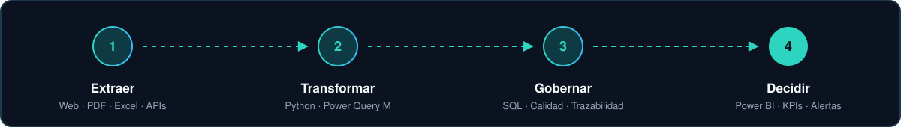

  

  
  
  
  
  
  
  
  
  
  
  
  
  
  
  
  

 

  <b>¿Tu equipo sigue copiando y pegando datos?</b> 
  Hablemos de qué proceso puede correr solo a partir del próximo mes.  
  
  

Santo Domingo, República Dominicana · Proyectos presentados de forma genérica, sin datos de clientes.

